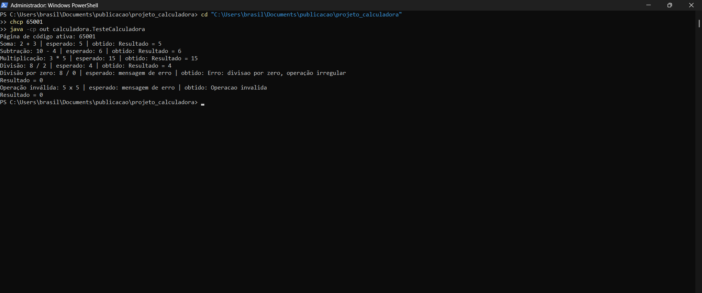
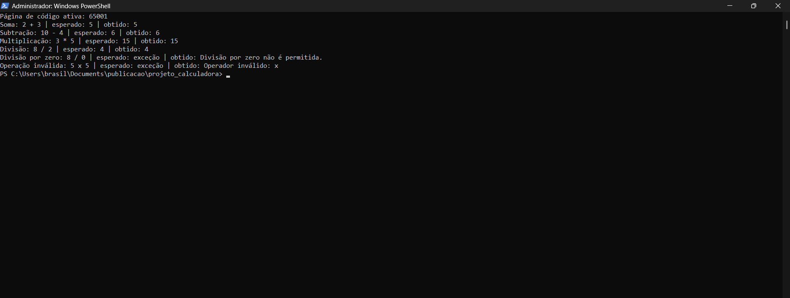
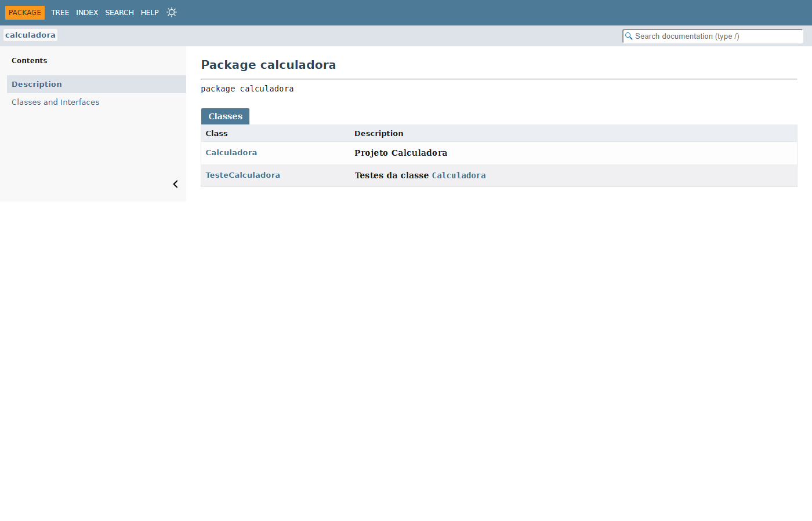
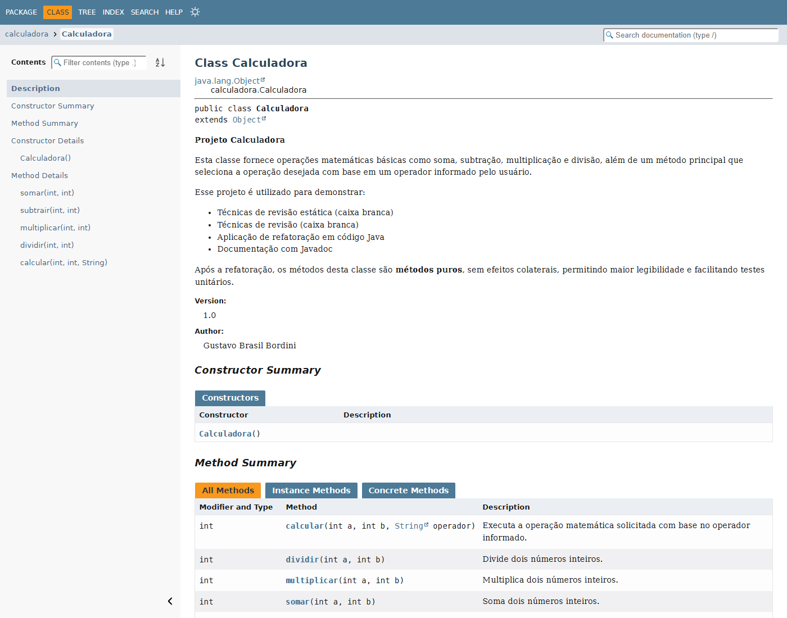

# Projeto Calculadora — FinançApp

> Projeto acadêmico desenvolvido com foco em Qualidade de Software, Testes, Refatoração, Documentação e Versionamento.

---

## 1. Identificação do Projeto

**Projeto:** Projeto Calculadora  
**Contexto:** FinançApp  
**Aluno:** Gustavo Brasil Bordini  
**RA:** 252212  
**Curso:** AS406TSN2 - UX/UI e Testes de Software  
**Disciplina:** UX/UI e Testes de Software  
**Professor:** Daniel Ohata  
**Semestre:** 2026.2  

---

# 2. Visão Geral

O projeto consiste no desenvolvimento de um módulo de cálculos matemáticos básicos em Java para a startup fictícia **FinançApp**.

O módulo foi desenvolvido com o objetivo de ser utilizado futuramente em funcionalidades de controle financeiro, como:

- orçamento mensal;
- divisão de despesas;
- projeções financeiras;
- cálculos auxiliares.

Além do funcionamento correto das operações, o projeto aplica práticas de qualidade de software relacionadas a:

- testes;
- tratamento de erros;
- refatoração;
- documentação;
- versionamento;
- manutenção de código.

---

# 3. Problema

Durante o desenvolvimento da aplicação FinançApp, foi identificada a necessidade de criar um módulo matemático reutilizável.

Entretanto, a equipe definiu que o módulo não deveria apenas funcionar corretamente, mas também apresentar:

- código legível;
- testes automatizados;
- tratamento de falhas;
- documentação técnica;
- controle de versões;
- facilidade de manutenção.

O desafio consiste, portanto, em desenvolver uma solução funcional e ao mesmo tempo aplicar boas práticas de Engenharia de Software.

---

# 4. Objetivo

## 4.1 Objetivo Geral

Desenvolver uma calculadora em Java aplicando práticas de qualidade, testes, documentação, refatoração e versionamento.

## 4.2 Objetivos Técnicos

- implementar operações matemáticas básicas;
- tratar entradas inválidas;
- impedir divisão por zero;
- desenvolver testes automatizados;
- refatorar o código sem alterar seu comportamento;
- documentar classes e métodos com JavaDoc;
- gerar documentação HTML;
- utilizar Git e GitHub;
- organizar commits e branches;
- manter documentação técnica no README.

---

# 5. Escopo Funcional

A aplicação deverá oferecer as seguintes operações:

| ID | Funcionalidade | Descrição | Status |
|---|---|---|---|
| RF01 | Soma | Soma dois números inteiros | ✅ |
| RF02 | Subtração | Subtrai dois números inteiros | ✅ |
| RF03 | Multiplicação | Multiplica dois números inteiros | ✅ |
| RF04 | Divisão | Divide dois números inteiros | ✅ |
| RF05 | Validação de divisão | Impede divisão por zero | ✅ |
| RF06 | Operação inválida | Trata operadores não suportados | ✅ |

---

# 6. Requisitos Não Funcionais

| ID | Categoria | Requisito |
|---|---|---|
| RNF01 | Qualidade | O código deve possuir organização e legibilidade |
| RNF02 | Testabilidade | As operações devem possuir testes automatizados |
| RNF03 | Manutenção | O código deve permitir refatoração sem alteração funcional |
| RNF04 | Documentação | Classes e métodos devem possuir JavaDoc |
| RNF05 | Versionamento | O projeto deve utilizar Git e GitHub |
| RNF06 | Confiabilidade | Erros não devem interromper inesperadamente a execução |

---

# 7. Tecnologias Utilizadas

| Tecnologia | Versão | Utilização |
|---|---|---|
| Java | 26.0.2 | Desenvolvimento |
| JDK | 26.0.2 | Compilação |
| Classe `TesteCalculadora` (método `main`) | — | Testes unitários executados pelo terminal, sem biblioteca externa |
| Git | 2.54.0 | Controle de versão |
| GitHub | — | Repositório remoto |
| JavaDoc | — | Documentação |
| IDE | Antigravity | Ambiente de desenvolvimento |

---

# 8. Estrutura do Projeto

```text
projeto_calculadora/
│
├── src/
│   └── calculadora/
│       └── Calculadora.java
│
├── test/
│   └── calculadora/
│       └── TesteCalculadora.java
│
├── docs/
│   └── index.html
│
├── images/
│   ├── testes/
│   ├── javadoc/
│   └── refatoracao/
│
├── README.md
├── .gitignore
└── demais arquivos do projeto
```

---

# 9. Explicação das Operações

A classe `Calculadora` faz as quatro operações básicas com números inteiros. Na versão final, o método principal é o `calcular(int a, int b, String operador)`: ele olha o operador recebido e chama o método da operação.

| Operador | Operação | Método | Exemplo | Resultado |
|---|---|---|---|---|
| `+` | Soma | `somar(a, b)` | `calcular(2, 3, "+")` | `5` |
| `-` | Subtração | `subtrair(a, b)` | `calcular(10, 4, "-")` | `6` |
| `*` | Multiplicação | `multiplicar(a, b)` | `calcular(3, 5, "*")` | `15` |
| `/` | Divisão | `dividir(a, b)` | `calcular(8, 2, "/")` | `4` |

Observações:

- A divisão é de números inteiros, então a parte decimal é descartada (`7 / 2` dá `3`).
- Se o divisor for zero, a divisão não é feita e aparece a mensagem `Divisão por zero não é permitida.`
- Se o operador não for `+`, `-`, `*` ou `/`, aparece a mensagem `Operador inválido: <operador>`.
- Na versão original (antes da refatoração), os dois erros mostravam a mensagem no console e o resultado era `0`. Depois da refatoração, os dois lançam `IllegalArgumentException`, e quem chama o método trata o erro com `try/catch`. Assim o programa não é interrompido.

---

# 10. Como Compilar e Executar

É preciso ter o JDK 17 ou superior. Na pasta do projeto, no PowerShell:

```powershell
# compila e gera as classes na pasta out/
javac -encoding UTF-8 -d out src/calculadora/Calculadora.java test/calculadora/TesteCalculadora.java

# executa os testes
java -cp out calculadora.TesteCalculadora
```

---

# 11. Testes

A classe `TesteCalculadora` chama a calculadora com a entrada de cada caso e mostra no console a entrada, o resultado esperado e o resultado obtido.

## 11.1 Casos de teste

| # | Caso | Entrada (a, b, operador) | Esperado | Obtido na versão original | Obtido na versão refatorada |
|---|---|---|---|---|---|
| 1 | Soma | 2, 3, `+` | `5` | `Resultado = 5` | `5` |
| 2 | Subtração | 10, 4, `-` | `6` | `Resultado = 6` | `6` |
| 3 | Multiplicação | 3, 5, `*` | `15` | `Resultado = 15` | `15` |
| 4 | Divisão | 8, 2, `/` | `4` | `Resultado = 4` | `4` |
| 5 | Divisão por zero | 8, 0, `/` | mensagem de erro | `Erro: divisao por zero, operação irregular` e `Resultado = 0` | `Divisão por zero não é permitida.` |
| 6 | Operação inválida | 5, 5, `x` | mensagem de erro | `Operacao invalida` e `Resultado = 0` | `Operador inválido: x` |

## 11.2 Execução dos testes (antes da refatoração)



## 11.3 Execução dos testes (depois da refatoração)



Nas duas versões os 6 casos deram o resultado esperado e nenhum deles interrompeu o programa.

---

# 12. Refatoração

A refatoração foi feita na branch `Refatoracao`. A ideia foi deixar o código mais organizado e fácil de ler, sem mudar o resultado das operações.

| O que foi feito | Antes | Depois |
|---|---|---|
| Extração de métodos | Toda a lógica dentro do `calc` | Um método para cada operação: `somar`, `subtrair`, `multiplicar` e `dividir` |
| Simplificação dos condicionais | Vários `if / else if` com `equals` | Um `switch` sobre o operador |
| Atributo `r` | Atributo público que mudava a cada chamada | Removido: os métodos só retornam o valor |
| Mensagens no console | O cálculo e o `System.out.println` ficavam no mesmo método | A classe só calcula; quem chama decide o que mostrar |
| Tratamento de erros | Mensagem no console e retorno `0` | `IllegalArgumentException` com mensagem clara |
| Nomes | `calc`, `op`, `r` | `calcular`, `operador` |

Depois de refatorar, rodei os testes de novo (seção 11.3) e os resultados continuaram corretos.

---

# 13. Documentação JavaDoc

As classes e os métodos foram comentados com JavaDoc, usando `@author`, `@version`, `@param`, `@return` e `@throws`. Para gerar a documentação, na pasta do projeto:

```powershell
javadoc -d docs -encoding UTF-8 -docencoding UTF-8 -charset UTF-8 -author -version src/calculadora/Calculadora.java test/calculadora/TesteCalculadora.java
```

Isso cria a pasta `docs/`. O arquivo `docs/index.html` abre no navegador.





---

# 14. Versionamento

O projeto está em um repositório no GitHub com duas branches:

| Branch | Conteúdo |
|---|---|
| `main` | Versão original e, depois do merge, também a versão refatorada com a documentação |
| `Refatoracao` | Código refatorado, testes atualizados, JavaDoc, pasta `docs/` e este README |

---

# 15. Link do Repositório

[https://github.com/brasil1812/projeto_calculadora](https://github.com/brasil1812/projeto_calculadora)
